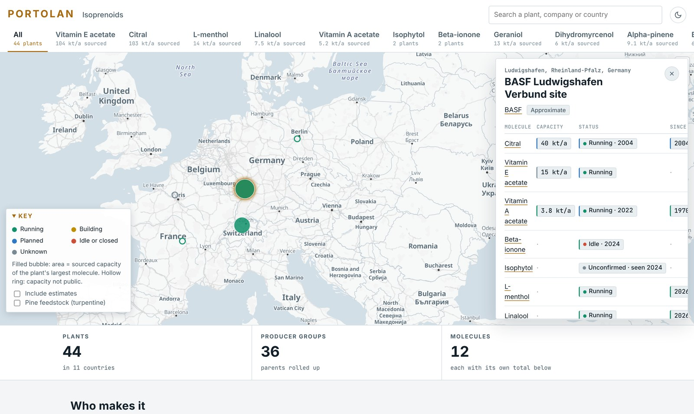

# Portolan

**The open map of where chemicals are made: every plant, every route, every number sourced.**

[**Open the map →**](https://lorenzoarbolino.github.io/portolan/)



Global Energy Monitor and others map the large building-block chemicals: olefins, aromatics, ammonia,
methanol. Portolan maps what is made from them: intermediates and specialties, plant by plant. For each plant it
records who operates and owns it, what it makes, how much it can make, whether it is running, and what has
happened there, with every value traced to the sentence that states it.

A portolan was a medieval sailing chart, drawn from what pilots had actually seen and corrected every time they
came back.

## The first chain: isoprenoids

Citral, linalool, geraniol, L-menthol, pinenes, myrcene, ionones and isophytol, up to vitamins A and E.
A handful of plants make the C10 building blocks behind both fragrances and vitamins. When BASF's citral plant in
Ludwigshafen caught fire in 2017, vitamin A and E supply went into force majeure across the market. China has
since added large new capacity.

| | |
|---|---|
| Sites | 103 in 12 countries: 44 plants on the main map, plus kraft mills and rosin plants on the pine-feedstock layer |
| Producers | 76 companies, grouped under their parents |
| Claims | 724 sourced values from 397 documents, 116 publishers, 7 languages (incl. 82 Chinese sources) |
| Events | 30 dated fires, start-ups, closures and acquisitions |
| Trade | Chinese customs exports and EU-27 imports, 2015–2025, wherever a customs code isolates the molecule |

## How it works

```
chain pack ─► research jobs ─► validators ─► data/ ─► resolve + build ─► map
               (LLM agents      (quote check,          (one value per field,
                propose values   units, geo,            per-molecule metrics)
                with quotes)     licence, privacy)
```

- **Agents propose, code decides.** LLM agents search the web and read filings, permits and trade press, then
  propose values together with a verbatim quote. Deterministic validators confirm each quote is on the page and
  its number matches, normalise units (t/a, MT/month, 万吨/年 …), and check location, licence and personal
  data. Anything uncertain goes to a review queue.
- **Graded sources.** A: primary source (permit, filing, company document). B: named trade press.
  C: an aggregator, or a quote that can't be checked automatically.
- **Unknown stays unknown.** The map opens on sourced values only. Estimates are opt-in and marked `~`, and a
  method is enabled only if it passes a leave-one-out backtest on that molecule's sourced plants
  ([`eval/estimates.md`](eval/estimates.md)).
- **No double counting.** Totals and shares are per molecule; capacities are never added along a chain.
- **Ownership over time.** Acquisitions move plants to the buyer from the deal date. `portolan audit` lists any
  place where the map contradicts itself.
- **Measured models.** Extraction models are scored on a hand-checked gold set (30 items, 11 traps, 8 non-English)
  before their output is trusted ([`eval/README.md`](eval/README.md)).

Full rules: [`docs/methodology.md`](docs/methodology.md). What each data source can and can't give:
[`docs/sources/`](docs/sources/).

## Run it

Python 3.12+ with [uv](https://docs.astral.sh/uv/), Node LTS for the map. `poppler-utils` and `tesseract` are
optional (scanned PDFs).

```bash
uv sync
uv run pytest                     # offline test suite
uv run portolan build             # data/ → build/app/*.json + build/graph.duckdb
uv run portolan audit             # coverage, estimates, duplicates, contradictions

cd app && npm ci
mkdir -p public/data && cp ../build/app/* public/data/
npm run dev                       # the map on localhost
```

Research runs need an agent CLI configured in [`pipeline/models.yaml`](pipeline/models.yaml):

```bash
uv run portolan plan --jobs J01 --molecule mol:5392-40-5 --region CN   # plan: citral producers in China
uv run portolan run <run-id> --n 4                                    # agents search and extract
uv run portolan collect <run-id>                                      # validate, grade, write proposals
uv run portolan cdr-pull --run <run-id>                               # US EPA register, no agent needed
```

## Repository

| Path | Contents |
|---|---|
| [`data/`](data/) | The dataset: companies, sites, units, claims, evidence, events, ownership transfers, trade flows |
| [`chains/`](chains/) | Chain definitions: molecules, routes, regions, must-find producers |
| [`portolan/`](portolan/) | Data model, resolution, estimates, metrics, audit, build, CLI |
| [`pipeline/`](pipeline/) | Planner, runner, agent adapters, job prompts, validators, source connectors |
| [`app/`](app/) | The web map (Vite, TypeScript, MapLibre) |
| [`eval/`](eval/) | Gold set, model scores, estimate backtests |
| [`schema/`](schema/) | JSON Schemas generated from the data model |
| [`docs/`](docs/) | Methodology and source notes |

## Corrections

Every plant sheet has an "Is this right?" link that opens a short correction form. A correction needs a public
source: every value keeps its quote, so a correction replaces a weaker source with a stronger one. To point
someone to a plant, link `https://lorenzoarbolino.github.io/portolan/?plant=<site-id>`.

## Licences

- **Code:** Apache-2.0 ([`LICENSE`](LICENSE)).
- **Data:** Open Database License 1.0 ([`DATA_LICENSE.md`](DATA_LICENSE.md)); sources credited in
  [`ATTRIBUTION.md`](ATTRIBUTION.md).
- The repository stores short quotes and links, never copies of source documents.

## Citation

See [`CITATION.cff`](CITATION.cff), or use GitHub's "Cite this repository" button.
